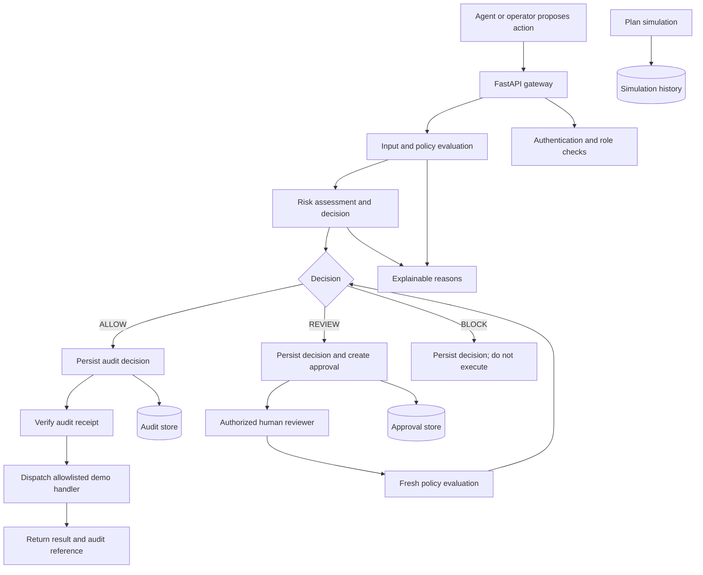

# AEGIS-X architecture

AEGIS-X is a governance layer for proposed AI-agent actions. The current implementation evaluates proposals and gates a small allowlist of harmless demonstration tools. It is not a universal agent-runtime monitor.

## Request and decision flow

## Main components

| Component | Responsibility |
|---|---|
| React + Vite dashboard | Operator, reviewer, and auditor interface |
| FastAPI application | API routes, request validation, and orchestration |
| Policy engine | Deterministic policy rules and explainable reasons |
| Risk and decision engines | Risk calculation and ALLOW / REVIEW / BLOCK classification |
| Execution gateway | Tool allowlist, audit-before-execution, and fail-closed dispatch |
| Approval store | Pending review and reviewer decisions |
| Audit store | Persistent decision records and SHA-256 hash-chain verification |
| Security API/store | Authentication, roles, session lifecycle, and security events |
| Simulation engine/store | Non-executing plan previews and simulation history |

## Trust boundaries and limitations

- An external agent must be explicitly integrated and configured so governed actions cannot bypass the gateway. A client library alone cannot enforce that boundary.
- Only registered demonstration handlers are enabled; no real cloud, payment, database, or operating-system operation is executed by the demo gateway.
- Policy decisions are deterministic rules, not an ML model.
- Evidence and event-source metadata are not independently attested.
- The audit hash chain is tamper-evident, not immutable or independently anchored.
- Production adoption would require independently reviewed integrations, least-privilege execution identities, stronger audit anchoring, operational monitoring, and a formal security assessment.

See the [demo walkthrough](DEMO_WALKTHROUGH.md), [external-agent integration contract](EXTERNAL_AGENT_INTEGRATION.md), and [production deployment runbook](PRODUCTION_DEPLOYMENT.md).
